  

  

  

  

  

  

  

<em>Every building is a day; taller buildings mean more contributions.</em>

  

  

  

25 public repositories, 215 contributions in the last year, a longest streak of 63 days and 1 follower.

  

  

  

  

  

  

<em>Top languages orbit as planets, repositories orbit as moons, and recent pushes streak across as comets.</em>

  

  

  
  &nbsp;&nbsp;
  

  

