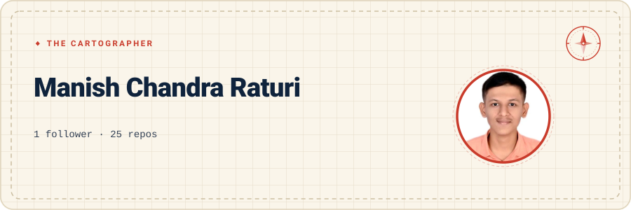

# The city I built this year

---

  

<em>Every building is a day; taller means more contributions.</em>

  

  

25 public repositories, 209 contributions in the last year, a longest streak of 63 days and 1 follower.

  

  <a href="https://github.com/manishchandraraturi">GitHub</a>
  &nbsp;·&nbsp;
  <a href="https://www.linkedin.com/in/manish-raturi-9bb028388/">LinkedIn</a>

